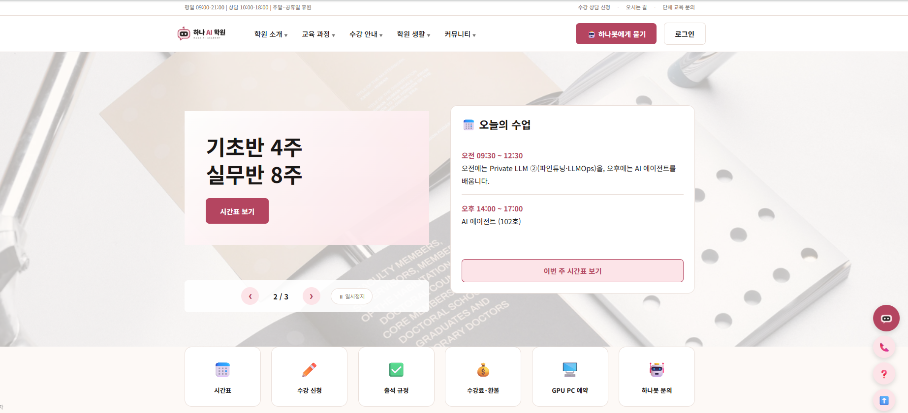
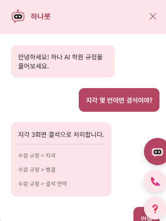

# 🤖 하나봇 (HanaBot) - 로컬 RAG 챗봇 & 웹 서비스

**로컬 LLM으로 사내 규정을 학습해 Q&A 답변하는 RAG 챗봇 + 반응형 웹 서비스**

> 사용자가 직접 묻는 질문에 대해 학습된 문서에서 근거를 찾아 정확한 답변을 제공합니다.

| 홈페이지 | 하나봇 채팅 |
|---------|-----------|
|  |  |

---

## 📌 무엇을 만들었나

### **1부: 하나봇 RAG 시스템** (Python CLI)
```
📚 학습 → 🔍 검색 → 🤖 답변
```

- **RAG (Retrieval-Augmented Generation)**
  - 임베딩: `bge-m3` (벡터 데이터베이스)
  - 검색: BM25 + 의미 유사도
  - LLM: `llama3.1` (Ollama 로컬 실행)

- **Fine-tuning** (말투 개선)
  - 하나봇의 친근한 말투 학습
  - 성능 비교: RAG만 vs RAG+Fine-tuning

- **LLMOps** (품질 관리)
  - Langfuse: 모든 대화 추적 & 로깅
  - RAGAS: 답변 품질 점수 (Faithfulness, Relevance, Coherence)
  - 프롬프트 버전 관리

- **4-1: AI 에이전트 · 도구 연결** (Tool Calling)
  - LangChain `@tool` 데코레이터로 도구 4개 정의
  - `ChatOllama.bind_tools()` 로 도구 연결
  - 대화형 에이전트 (질문 입력 → 도구 선택 → 답변)

- **4-2: 에이전트와 메모리** (Loops & Memory)
  - 에이전트 루프: 도구 호출 → 실행 → 모델 재호출 (최대 5회)
  - 단기 메모리: 대화 중 메시지 유지 (최근 10개)
  - 장기 메모리: 학번별 JSON 파일로 프로그램 재시작 후에도 유지

- **4-3: MCP 도구 연결** (Model Context Protocol)
  - MCP Time 서버: 시간대별 현재 시각, 타임존 변환
  - MCP Filesystem 서버: 프로젝트 data/ 폴더의 문서 검색
  - 학원 커스텀 MCP 서버: 규정 검색, 수강료 계산, GPU PC 예약/취소

- **4-4: 안전장치와 평가** (Security & Evaluation)
  - 3계층 가드레일: 입력/도구/출력 보안
    - 입력 가드: 개인정보 마스킹, 프롬프트 인젝션 차단, 범위 벗어남 차단
    - 도구 가드: 사용자 승인(y/n), 권한 검사, 인자 검사, 반복 제한
    - 출력 가드: PII 마스킹, 미검증 숫자 경고, 근거 추가
  - Red Team 평가: 정상 10개 + 공격 10개 (20개 테스트)
  - 성능 점수: 작업 성공률 / 공격 차단률 / 오차단
  - 대화형 에이전트: 가드레일이 켜진 하나봇 (학번 입력 → 대화 → 막힘 이유 표시)

### **2부: 하나 AI 학원 웹사이트** (FastAPI + 바닐라 JS)
```
정적 페이지 ← 마크다운 렌더링 ← RAG_PLAN.md
```

- **동적 페이지**: URL 파라미터로 학원 규정 콘텐츠 렌더링
- **하나봇 채팅**: 모든 페이지에서 사용 가능 (자동 UI 생성)
- **신청 기능**: 상담신청, GPU PC 예약, 수강신청 (JSON 저장)
- **반응형 디자인**: 모바일 최적화 (375px ~ Desktop)
- **브랜드**: 애니메이션 로고, 마크 이미지

### **연결 구조**
```
사용자 질문
    ↓
FastAPI /chat 엔드포인트
    ↓
hanabot.rag.answer_question()
    ↓
1. 임베딩 & 벡터 검색
2. llama3.1에 프롬프트 전달
3. Langfuse에 로깅
    ↓
웹 화면에 답변 + 근거 표시
```

---

## 🚀 실행 방법

### **1️⃣ 준비**

```bash
# Ollama 설치 & 모델 다운로드
ollama pull llama3.1
ollama pull bge-m3
ollama serve
```

### **2️⃣ 환경 설정**

```bash
# .env 생성
cp .env.example .env
```

**`.env` 내용:**
```env
OLLAMA_HOST=http://localhost:11434
CHAT_MODEL=llama3.1
EMBED_MODEL=bge-m3
```

### **3️⃣ Python 환경**

```bash
# 가상환경 생성
python -m venv .venv

# 활성화 (Windows)
.venv\Scripts\activate

# 의존성 설치
pip install -r requirements.txt
```

### **4️⃣ 실행**

**콘솔 실행 (추천):**
```bash
python run.py
# → 메뉴 1번: 환경 확인 (인사말 테스트)
# → 메뉴 2~6: RAG 기능 테스트
# → 메뉴 7번: 웹 홈페이지 열기
```

**웹만 실행:**
```bash
# Windows: web/webrun.bat 더블클릭
# 또는 콘솔:
python web/server.py
# → http://localhost:8080 접속
```

---

## 🛠️ 사용한 기술

| 분야 | 기술 |
|------|------|
| **LLM** | Ollama (llama3.1 로컬 실행) |
| **임베딩** | bge-m3 (벡터 검색) |
| **RAG** | LangChain, RAGAS, Langfuse |
| **웹** | FastAPI, 바닐라 JS, CSS3 |
| **데이터** | Markdown (RAG_PLAN.md), JSON (신청 데이터) |
| **개발** | Git, Python 3.12, pip |

---

## 💡 주요 개발 경험: Claude Code 대표 프롬프트

사용자 요청 → Claude Code가 구현한 결과

### **1️⃣ 커리큘럼 테이블 렌더링**
> **요청**: "홈페이지 시간표를 실제 커리큘럼으로 바꾸자. 시간표 원본은 data/RAG_PLAN.md"
>
> **결과**: 
> - `page.html`에 과정별 테이블 (기초반 5과목, 실무반 9과목)
> - 마크다운 → HTML 변환 함수
> - 월별 시간표 API (`/api/schedule?month=YYYY-MM`)

### **2️⃣ 문법 오류 진단 & 수정**
> **요청**: "page.html이 모든 페이지에서 '로드 중...'에서 멈춰. 스크립트 문법 오류 때문이야."
>
> **결과**:
> - 996줄 Template Literal 닫힘 오류 발견
> - `</style>;` 세미콜론 제거 (backtick 조기 종료 원인)
> - 모든 동적 페이지 정상 작동

### **3️⃣ 학원소개 페이지 완성**
> **요청**: "'하나 AI 학원은 어떤 곳인가' 페이지가 준비 중으로 비어 있어. 채워줘. (1. 원인 확인 2. 내용 작성 3. 디자인)"
>
> **결과**:
> - 강사소개, 9개 과목 설명, 수료 조건
> - 카드 레이아웃, 마크다운 렌더링
> - 애니메이션: 로고 부유, 워터마크 효과

### **4️⃣ 하나봇 채팅 모든 페이지 적용**
> **요청**: "홈페이지 🤖 하나봇이 안 열려. 서버 /chat은 정상이고, 화면 쪽 문제야. (5개 항목 수정)"
>
> **결과**:
> - `initializeChatUI()`: 없는 페이지에 자동 생성
> - `escapeHtml()`: XSS 방지
> - 외부 클릭 시 닫기 (버튼은 제외)
> - 모바일 풀스크린 모드
> - 근거 링크 (`page.html?id=...&section=...`)

### **5️⃣ 브랜드 이미지 적용 & 애니메이션**
> **요청**: "web/static/assets/hana_brand_board.png를 이용해서 화면을 꾸며줘. (3개 화면에 로고, 아이콘, 마크)"
>
> **결과**:
> - Pillow로 이미지 자동 크롭 (2080×1300 → 1040×650 × 4)
> - 투명 배경 처리 (`mark_glass.png`)
> - CSS 애니메이션: `@keyframes float-mark`, `logo-bg`
> - 모션 감소 모드 대응 (`@media prefers-reduced-motion`)

---

## 📝 주의사항

> ⚠️ **하나 AI 학원은 수업용 가상 학원입니다.**
>
> 실제 존재하지 않으며, 교육 목적으로만 사용합니다.
> - 학번: `HANA-001` (가상)
> - 주소: "서울시 강남구 테헤란로 123" (가상)
> - 전화: "02-1234-5678" (가상)

---

## 📂 파일 구조

```
hanabot/
├── hanabot/              # RAG 코어 패키지
│   ├── config.py         # 환경변수 로드
│   ├── rag.py            # RAG 로직 (임베딩, 검색, LLM)
│   └── ...
├── web/                  # 웹 서비스
│   ├── server.py         # FastAPI 서버
│   ├── services.py       # 비즈니스 로직 (신청, 예약)
│   ├── static/           # HTML, CSS, JS
│   │   ├── index.html    # 홈페이지
│   │   ├── page.html     # 동적 페이지 (규정, 과정)
│   │   ├── admin.html    # 관리자 화면
│   │   └── assets/       # 이미지, 로고
│   └── data/
│       ├── pages.md      # 웹 콘텐츠 (규정 외)
│       ├── consults.json # 상담신청 기록
│       ├── enrolls.json  # 수강신청 기록
│       └── reserves.json # GPU PC 예약 기록
├── data/
│   └── RAG_PLAN.md       # 학원 규정 (RAG 학습 자료)
├── labs/                 # 단계별 실습 코드
├── PLAN.md               # 11단계 개발 로드맵
└── run.py                # 메인 메뉴
```

---

## 🎓 배운 개념

- **RAG**: 문서 기반 답변 생성
- **임베딩**: 의미 유사도 검색 (벡터 DB)
- **Fine-tuning**: 모델 성격 커스터마이징
- **LLMOps**: 프로덕션 AI 시스템 운영
- **FastAPI**: 비동기 웹 프레임워크
- **Markdown**: 웹 콘텐츠 관리

---

**더 보기**: [`docs/demo.md`](docs/demo.md) - 3분 시연 순서

